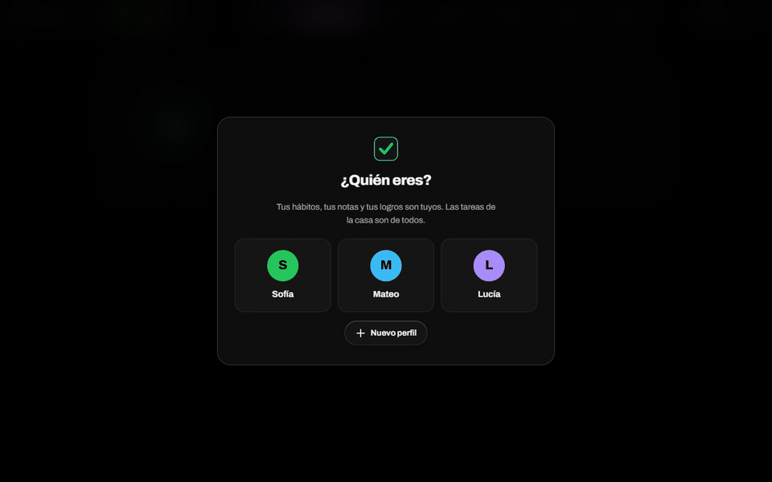

# Metanoia — Habit Tracker

**A habit, work and household-chores app for the whole home.** It runs on one PC on the local network; each person opens it from their phone as an installable app (PWA), changes show up live on every device, and push notifications arrive even when the app is closed.




*A fictional three-person household: closing out a perfect day, Work Mode, chores, history and the rank ladder.*

> **Language note:** built for a Spanish-speaking household, so the UI and code comments are in Spanish. This README and the code identifiers are the entry point for English readers.

---

## Features

- **Habits** with weekday schedules, streaks, a yearly heatmap, calendar, per-habit stats, achievements and a 30-perfect-days challenge.
- **Competitive progression**: XP and levels, a divisioned rank system (Iron I → Radiant) and a league between household members.
- **Shared challenges** between members, with a board of public habits.
- **Work Mode**: prioritized tasks, step-by-step guides, a progress log and rewards for finishing on time.
- **Home**: members, chores, assignments and schedules.
- **Rich-text notes** with fonts, colors, highlighting, tags and pasted images.
- **Profiles with optional passwords** and per-device sessions.
- **Reminders and push notifications** while the app is closed.
- **Synthesized sound** with Web Audio (no audio files) and animations that honor `prefers-reduced-motion`.

## Tech stack

| Layer | Technology |
|---|---|
| Server | Node.js, Express 4, native `https` and `crypto` modules |
| Notifications | `web-push` (VAPID) and a Service Worker |
| Real time | Server-Sent Events |
| Frontend | Vanilla JavaScript, no framework or build step; SVG and the Web Audio API |
| Install | PWA (manifest + service worker) |
| Security | Self-hosted certificate authority via OpenSSL, per-user salted `scrypt` |
| Persistence | JSON with atomic writes and versioned schema migrations |

## Technical highlights

### 1. HTTPS on a home network with a self-hosted certificate authority
Service workers and push notifications require a secure context, and `http://192.168.x.x` isn't one. A self-signed certificate isn't enough: the browser shows the page after the warning but **refuses to register the service worker**, so notifications fail silently. The fix is two certificates: a home CA that each device installs once, and a server certificate signed by it with the network addresses as SANs. When the IP changes, only the server certificate is re-signed and no device has to reinstall anything. A second HTTP port only redirects. → [`crear-cert.js`](crear-cert.js), [`confiar.js`](confiar.js)

### 2. End-to-end push notifications
VAPID keys are generated once and persisted (if they change, every existing subscription breaks), subscriptions are per device, reminders are scheduled server-side, and a service worker shows the notification with the app closed. The service worker also tells the app when a push reached the browser, which separates "it never arrived" from "it arrived and the OS silenced it" — two different failures fixed in two different places. Includes a diagnostic script that drives a browser over the DevTools protocol to isolate the fault. → [`public/sw.js`](public/sw.js), [`entrega.js`](entrega.js)

### 3. Live sync across devices with SSE
Every write is broadcast to all clients over Server-Sent Events: no libraries, with the browser's built-in reconnection. A heartbeat every 25 s keeps home routers from dropping the idle connection, the `X-Accel-Buffering: no` header stops proxies from batching events, and each client carries an ID so it can ignore the echo of its own changes.

### 4. Safe persistence and schema evolution
Data is written to a temporary file and swapped in with `rename` (atomic: a power cut can't leave a half-written file). Three chained migrations (v1 → v2 → v3) upgrade old data on startup, keeping a backup of each previous version. Passwords are stored as salted `scrypt` hashes and compared with `timingSafeEqual`. An environment variable redirects data to another folder so no test ever touches real data.

## Getting started

Requires Node.js 18+ and OpenSSL on the `PATH`.

```bash
npm install
npm run cert       # creates the home CA and the server certificate (once)
npm run confiar    # installs the CA on this machine (Windows)
npm start          # https://localhost:4173
```

Other devices open `https://<pc-ip>:4173`, download the CA from `/ca` and install it once. Without a certificate the server falls back to plain HTTP and everything works except notifications.

| Variable | Purpose |
|---|---|
| `PORT` | HTTPS port (default 4173). The HTTP redirect port is `PORT + 1` |
| `OBSIDIAN_VAULT` | Root folder; data lives in `<vault>/Habits/` (default `~/Documents/Obsidian Vault`) |
| `METANOIA_DATOS` | Alternative data folder, used by tests and demos |

> The `cert/` folder holds private keys (CA, server and VAPID) and is excluded from the repository. Regenerate it with `npm run cert`.

## Project structure

```
server.js        REST API, SSE, push, sessions, migrations and HTTPS startup
crear-cert.js    self-hosted CA + server certificate via OpenSSL
confiar.js       installs the CA in the user certificate store (certutil)
entrega.js       push-channel diagnostics with a controlled browser
public/
  app.js         SPA: views, streak/XP/rank calculations, notes editor
  sw.js          notification service worker
  icons.js       SVG iconography
  manifest.json  PWA install manifest
```
